# Laboratorium infrastruktury IT

Środowisko wirtualne odwzorowujące infrastrukturę małej firmy: segmentacja sieci na firewallu, domena Active Directory, system zgłoszeń zintegrowany z katalogiem LDAP oraz monitoring wszystkich hostów.

Projekt zbudowany w VirtualBox na pojedynczym hoście. Dokumentacja obejmuje pięć zrealizowanych etapów.

## Topologia

```
                    Internet
                       |
                  [ NAT VirtualBox ]
                       |
                  +----------+
                  | pfSense  |  WAN: NAT
                  |          |  LAN: 192.168.1.1
                  +----------+
                       |
        LAN 192.168.1.0/24 (Internal Network)
                       |
    +----------+-------+--------+-------------+
    |          |                |             |
 DC01       srv-helpdesk   srv-monitor   PC-Pracownik01
 .1.10        .1.20           .1.30          DHCP
```

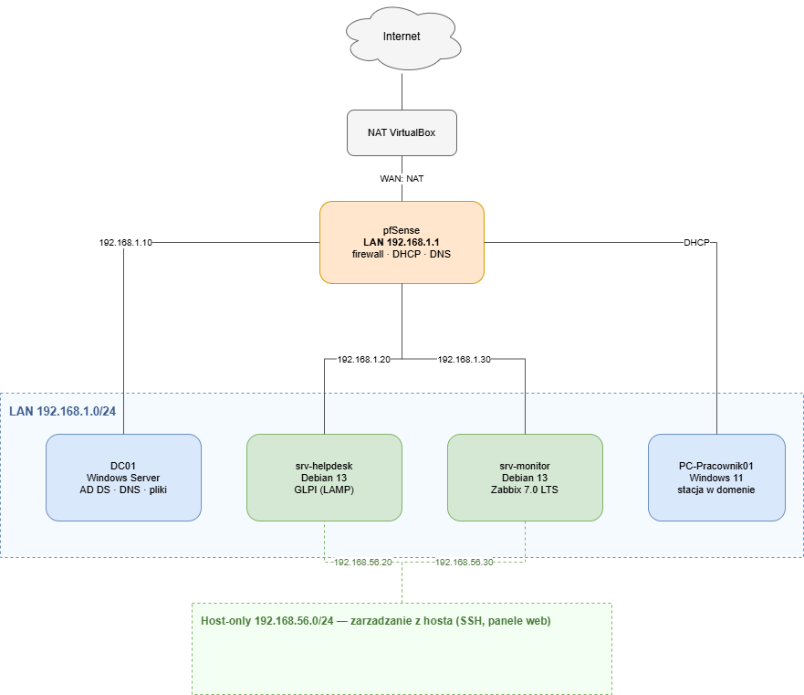

Wersja edytowalna: `diagram/topologia-sieci.drawio`.

Druga karta sieciowa na serwerach Debian (`enp0s8`) pracuje w sieci Host-only `192.168.56.0/24` i służy wyłącznie do zarządzania z hosta (SSH, dostęp do paneli webowych).

## Hosty

| Host | System | LAN | Host-only | Rola |
|---|---|---|---|---|
| pfSense | pfSense 2.7.2-RELEASE (FreeBSD 14.0) | 192.168.1.1 | - | Firewall, router, DHCP, DNS resolver |
| DC01 | Windows Server | 192.168.1.10 | - | AD DS, DNS, serwer plików |
| srv-helpdesk | Debian 13 (trixie) | 192.168.1.20 | 192.168.56.20 | LAMP, GLPI |
| srv-monitor | Debian 13 (trixie) | 192.168.1.30 | 192.168.56.30 | Zabbix Server 7.0 LTS |
| PC-Pracownik01 | Windows 11 | DHCP | - | Stacja kliencka w domenie |

## Wykorzystane technologie

- pfSense 2.7.2 (firewall, NAT, DHCP, SNMP)
- Windows Server: Active Directory Domain Services, DNS, GPO, uprawnienia NTFS
- Debian 13, Apache 2.4.68, MariaDB 11.8.6, PHP 8.4.23
- GLPI (ITSM) z uwierzytelnianiem LDAP
- Zabbix 7.0.28 LTS (server, frontend, agent 2), SNMPv2c
- PowerShell (automatyzacja tworzenia obiektów AD)
- Kopia zapasowa GLPI: skrypt bash, harmonogram cron

## Etap 1: Sieć i firewall

pfSense skonfigurowany jako firewall brzegowy oddzielający sieć wewnętrzną (LAN 192.168.1.0/24) od internetu (WAN przez NAT VirtualBox). Wyłączono blokowanie adresacji RFC1918 na interfejsie WAN ze względu na charakter środowiska testowego - NAT VirtualBox przydziela adres prywatny.

Usługi na pfSense: DHCP dla segmentu LAN, resolver DNS, reguły filtrowania ruchu.

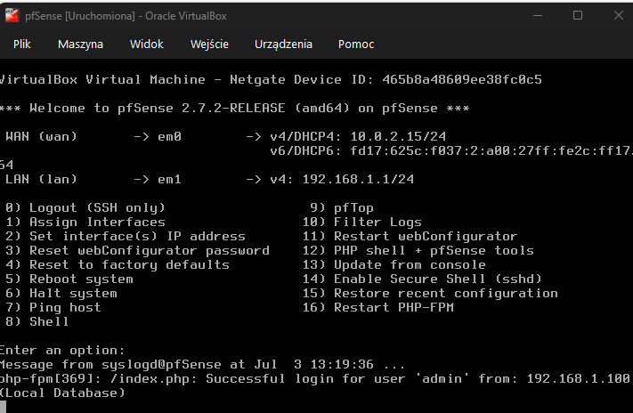

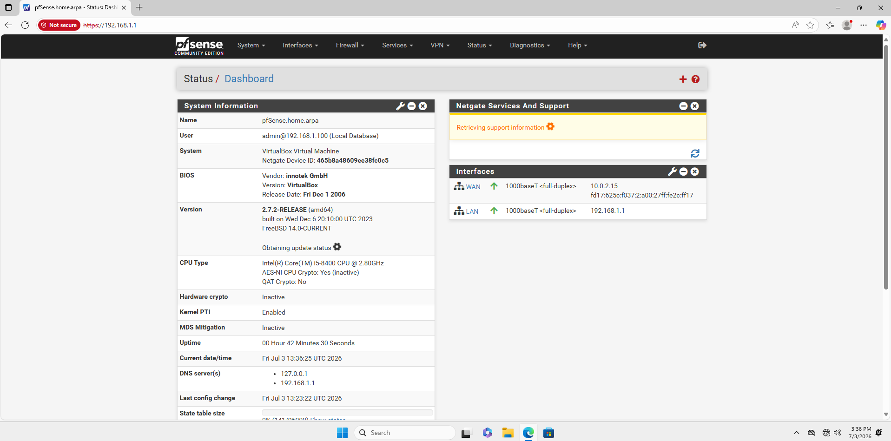

Pozostała dokumentacja etapu: `01`–`04`

## Etap 2: Active Directory

Domena `firma.local` na kontrolerze DC01. Struktura organizacyjna oparta o `OU=Dzialy` z jednostkami podrzędnymi odpowiadającymi działom firmy.

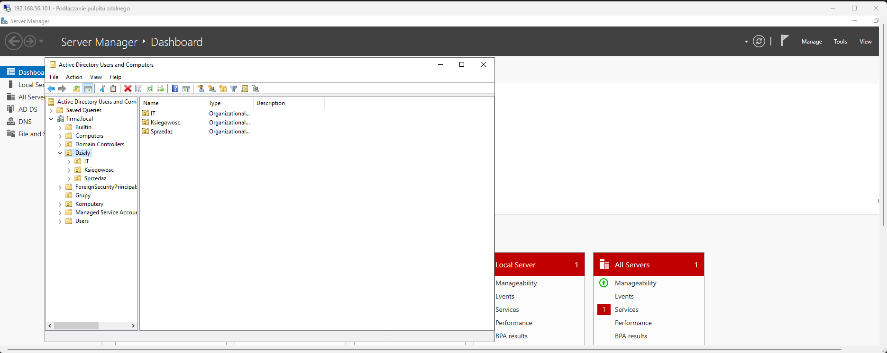

Użytkownicy tworzeni skryptem PowerShell zamiast ręcznie przez GUI:

```powershell
Get-ADUser -Filter * | Select Name, SamAccountName
```

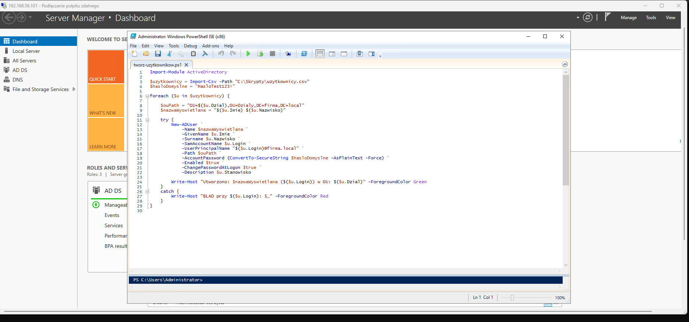

Pełny skrypt: `skrypty/tworz-uzytkownikow.ps1`.

Konta w domenie: `jan.kowalski`, `anna.nowak`, `piotr.wisniewski`, `maria.zielinska`, `tomasz.lewandowski` oraz konto serwisowe `glpi-bind`.

Serwer plików z udziałami per dział. Kontrola dostępu realizowana przez uprawnienia NTFS przypisane do grup domenowych - użytkownik widzi wyłącznie zasób własnego działu. Mapowanie dysków sieciowych rozprowadzane przez GPO (Drive Maps) z filtrowaniem po grupie bezpieczeństwa.

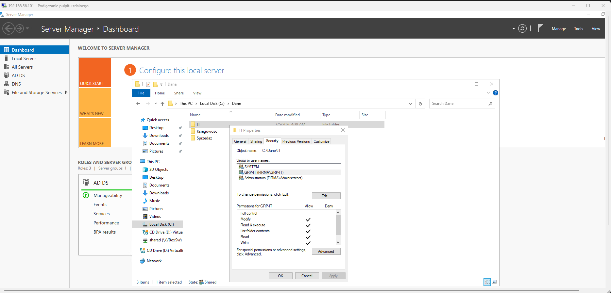

Test izolacji: użytkownik próbujący otworzyć zasób innego działu otrzymuje odmowę dostępu, przy jednoczesnym zachowaniu dostępu do własnego katalogu.

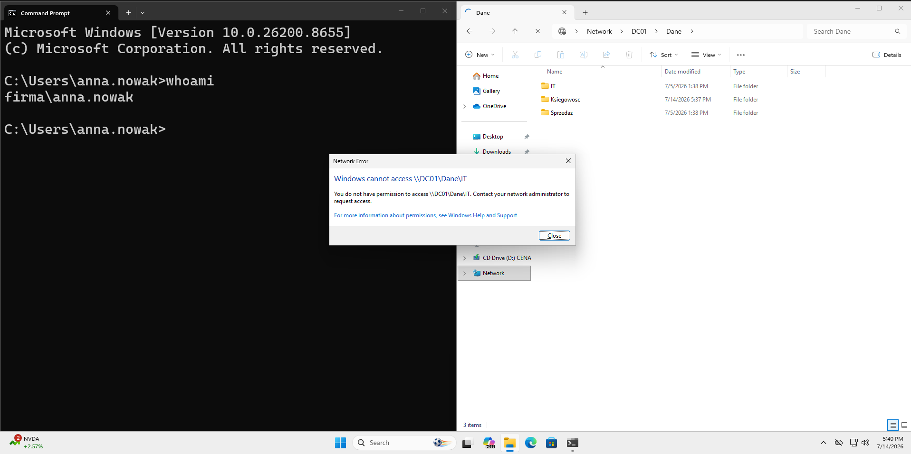

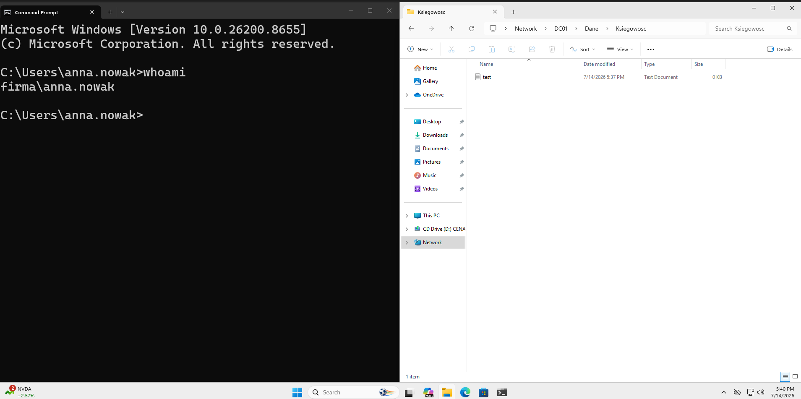

Weryfikacja zastosowanych polityk na stacji klienckiej:

```powershell
gpresult /r
```

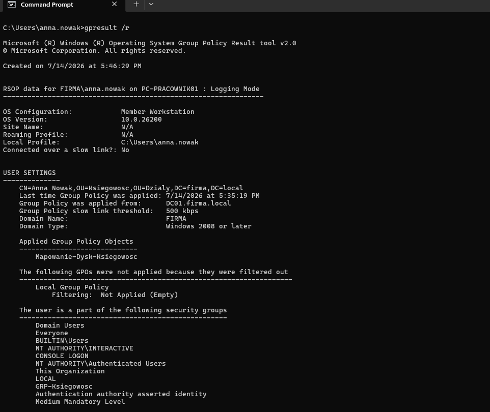

Pozostała dokumentacja etapu: `05`–`18`

## Etap 3: System zgłoszeń GLPI

Serwer `srv-helpdesk` z pełnym stosem LAMP:

```bash
sudo apache2 -v && mariadb --version && php -v
```

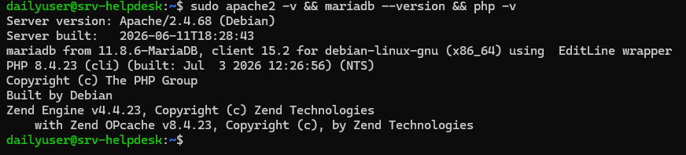

GLPI zainstalowane pod `/var/www/html/glpi`, vhost Apache wskazuje na `/var/www/html/glpi/public`.

### Integracja LDAP z Active Directory

Konfiguracja katalogu w GLPI (Setup -> Authentication -> LDAP directories):

| Parametr | Wartość |
|---|---|
| Server | 192.168.1.10 |
| Port | 389 |
| BaseDN | `OU=Dzialy,DC=firma,DC=local` |
| RootDN | `glpi-bind@firma.local` |
| Login field | `samaccountname` |

Uwierzytelnianie bindem realizowane przez dedykowane konto serwisowe `glpi-bind`, nie przez konto administratora domeny.

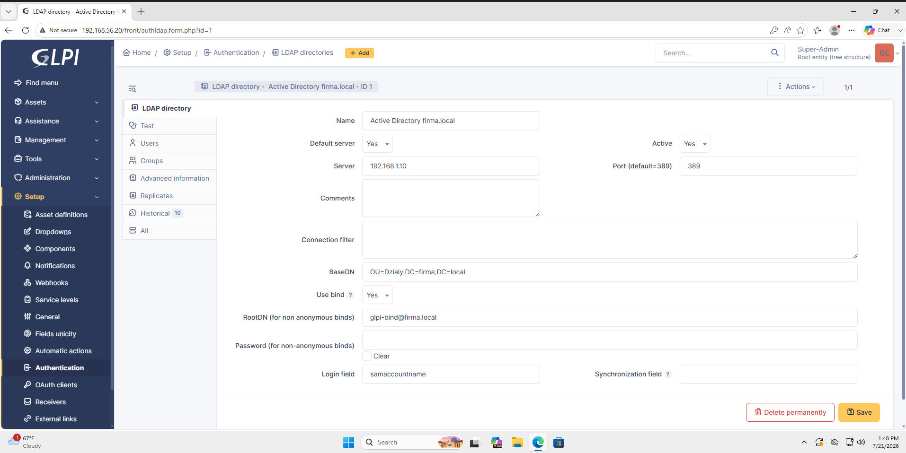

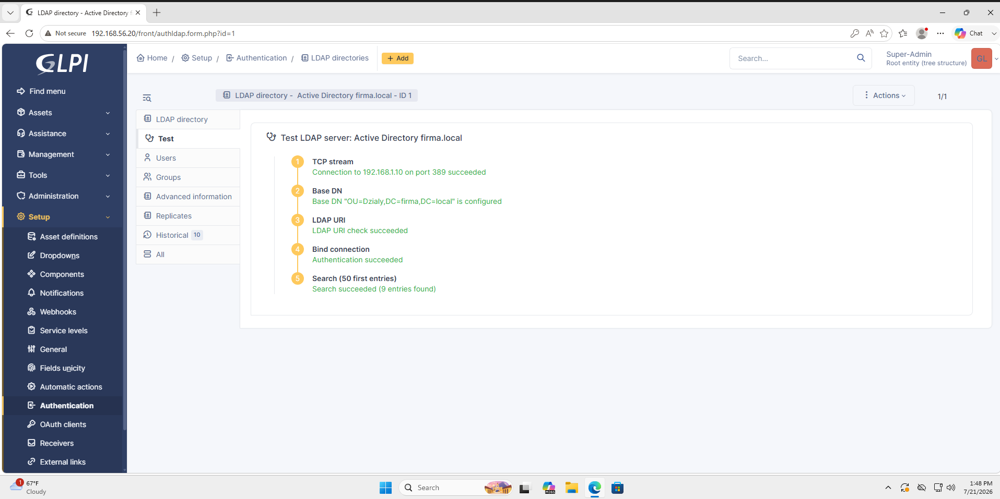

Synchronizacja użytkowników z linii poleceń:

```bash
sudo -u www-data php bin/console ldap:synchronize_users \
  --only-create-new --ldap-server-id=1 --no-interaction
```

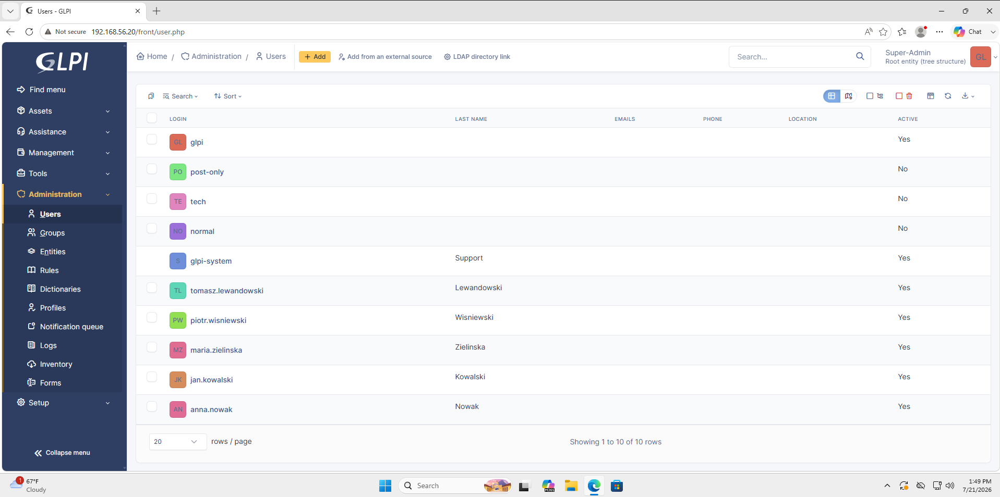

Efekt: pracownik loguje się do GLPI poświadczeniami domenowymi, wybierając źródło `Active Directory firma.local` zamiast lokalnej bazy GLPI.

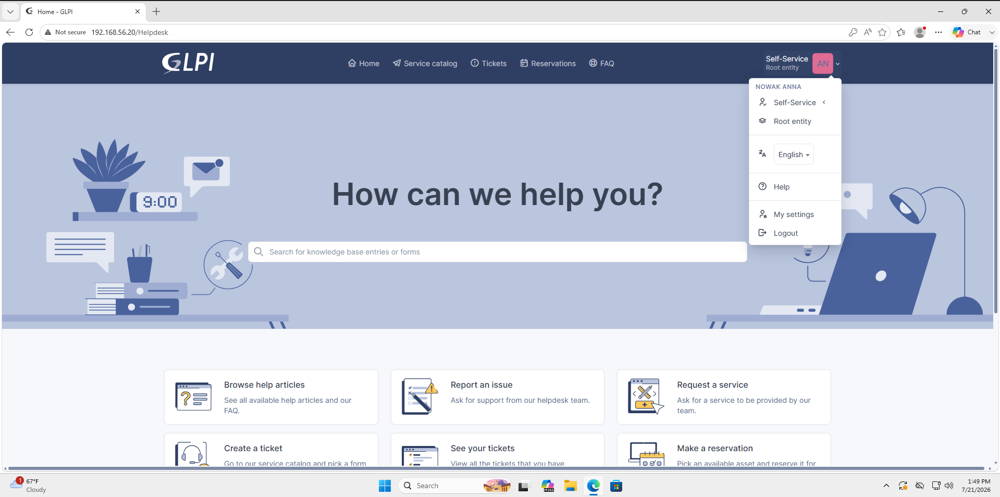

Pozostała dokumentacja etapu: `19`–`28`

## Etap 4: Monitoring

Serwer `srv-monitor` utworzony przez sklonowanie działającej maszyny `srv-helpdesk` (Full clone z regeneracją adresów MAC), co pozwoliło pominąć instalację systemu i stosu LAMP od zera. Po sklonowaniu nadano maszynie odrębną tożsamość:

```bash
sudo hostnamectl set-hostname srv-monitor
sudo sed -i 's/srv-helpdesk/srv-monitor/g' /etc/hosts
sudo rm -f /etc/machine-id /var/lib/dbus/machine-id
sudo systemd-machine-id-setup
sudo dbus-uuidgen --ensure
sudo rm -f /etc/ssh/ssh_host_*
sudo ssh-keygen -A
```

Adresacja zmieniona na `.30` w obu sieciach, pozostałości po GLPI (baza `glpidb`, vhost, katalog webowy) usunięte przed instalacją Zabbixa.

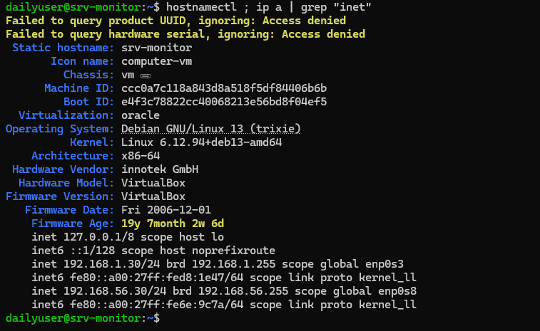

### Instalacja Zabbix Server

Wybrano linię 7.0 LTS ze względu na długi okres wsparcia.

```bash
wget https://repo.zabbix.com/zabbix/7.0/debian/pool/main/z/zabbix-release/zabbix-release_latest_7.0+debian13_all.deb
sudo dpkg -i zabbix-release_latest_7.0+debian13_all.deb
sudo apt update
sudo apt install -y zabbix-server-mysql zabbix-frontend-php \
  zabbix-apache-conf zabbix-sql-scripts zabbix-agent2
```

Utworzenie bazy i import schematu:

```sql
create database zabbix character set utf8mb4 collate utf8mb4_bin;
create user zabbix@localhost identified by '<haslo>';
grant all privileges on zabbix.* to zabbix@localhost;
set global log_bin_trust_function_creators = 1;
```

```bash
zcat /usr/share/zabbix-sql-scripts/mysql/server.sql.gz \
  | mysql --default-character-set=utf8mb4 -uzabbix -p zabbix
```

Hasło bazy wpisane w `/etc/zabbix/zabbix_server.conf` (`DBPassword`). Po pierwszym logowaniu zmieniono domyślne poświadczenia konta `Admin`.

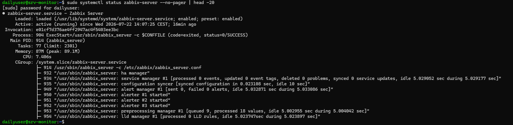

### Monitorowane hosty

| Host | Interfejs | Szablon | Metoda |
|---|---|---|---|
| Zabbix server | 127.0.0.1:10050 | Linux by Zabbix agent, Zabbix server health | Agent 2 |
| DC01 | 192.168.1.10:10050 | Windows by Zabbix agent | Agent 2 |
| srv-helpdesk | 192.168.1.20:10050 | Linux by Zabbix agent | Agent 2 |
| pfSense | 192.168.1.1:161 | PFSense by SNMP | SNMPv2c |

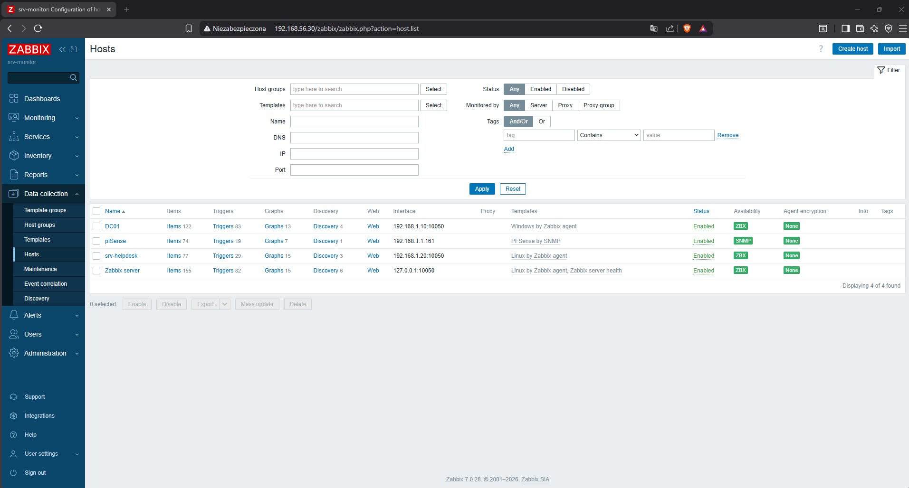

### Agent na Windows Server

Instalacja bezobsługowa z parametrami konfiguracyjnymi:

```powershell
msiexec /i zabbix_agent2.msi /qn SERVER=192.168.1.30 `
  SERVERACTIVE=192.168.1.30 HOSTNAME=DC01 LISTENPORT=10050
```

Otwarcie portu agenta w zaporze:

```powershell
New-NetFirewallRule -DisplayName "Zabbix Agent" -Direction Inbound `
  -Protocol TCP -LocalPort 10050 -Action Allow
```

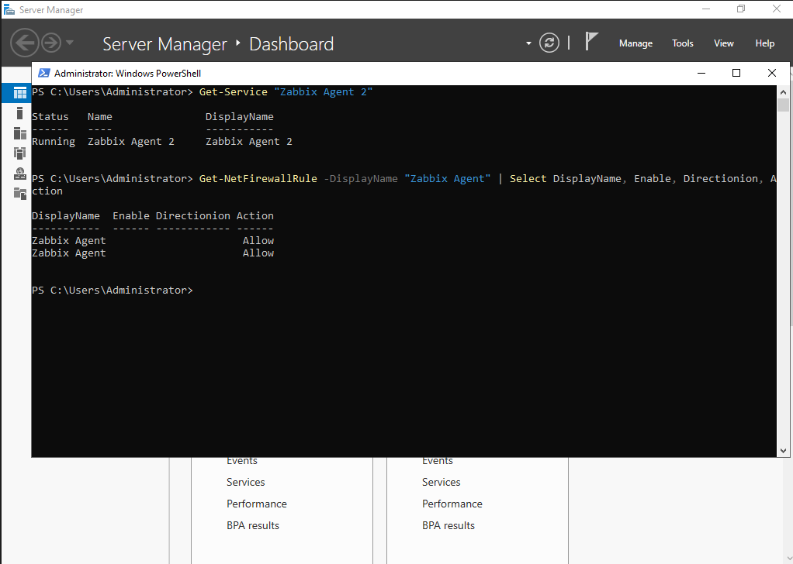

Przy okazji rozwiązano problem rozwiązywania nazw zewnętrznych na kontrolerze domeny - serwer DNS nie miał skonfigurowanych forwarderów:

```powershell
Add-DnsServerForwarder -IPAddress 192.168.1.1
Clear-DnsServerCache -Force
```

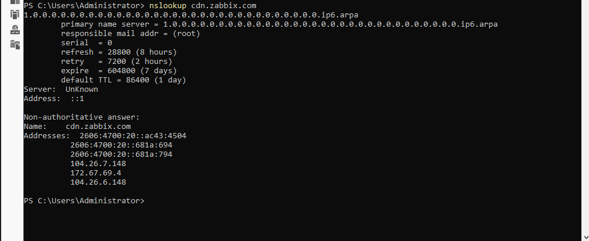

### Agent na Debianie

Konfiguracja w `/etc/zabbix/zabbix_agent2.conf`:

```
Server=192.168.1.30
ServerActive=192.168.1.30
Hostname=srv-helpdesk
```

### pfSense przez SNMP

Demon SNMP włączony w Services -> SNMP, port 161, binding na interfejs LAN, moduły MibII, Netgraph, PF, Host Resources, UCD, Regex. Domyślny community string zastąpiony własnym.

W Zabbixie community przekazywane makrem `{$SNMP_COMMUNITY}` zamiast wartości wpisanej wprost w interfejsie hosta.

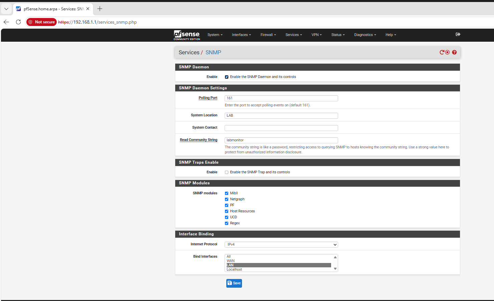

### Weryfikacja

Odpytanie agentów bezpośrednio z serwera monitoringu:

```bash
zabbix_get -s 192.168.1.10 -k agent.ping
zabbix_get -s 192.168.1.10 -k system.hostname
zabbix_get -s 192.168.1.20 -k agent.ping
```

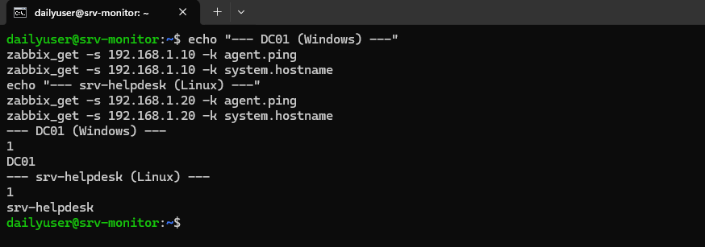

Test SNMP przed dodaniem hosta w panelu (Debian nie ma domyślnie kompletu MIB, stąd numeryczny OID):

```bash
snmpwalk -v2c -c <community> 192.168.1.1 1.3.6.1.2.1.1 2>/dev/null
```

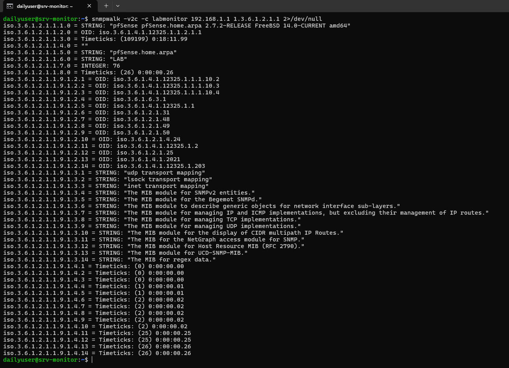

Metryki zbierane z kontrolera domeny i firewalla:

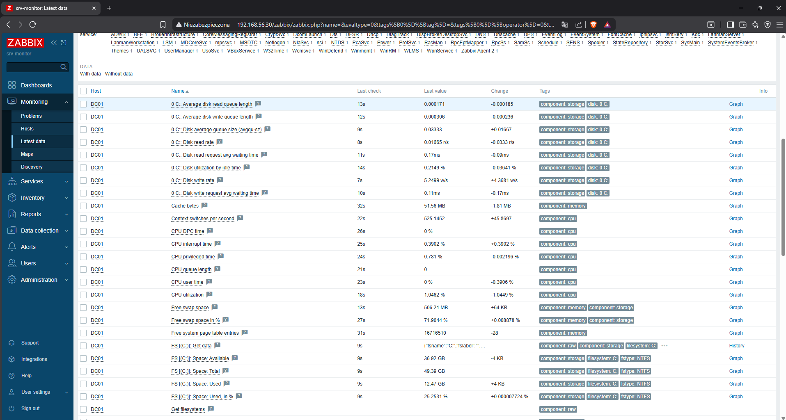

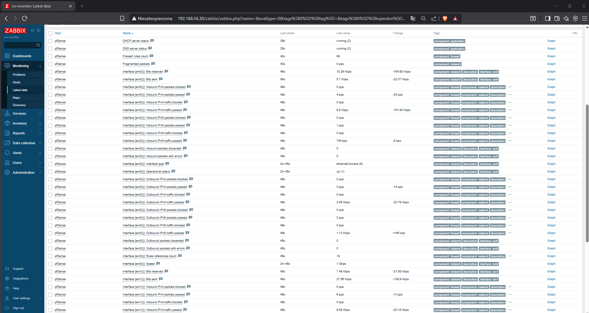

### Test alertowania

Symulacja awarii usługi i weryfikacja pełnego cyklu życia zdarzenia:

```bash
sudo systemctl stop zabbix-agent2      # awaria
sudo systemctl start zabbix-agent2     # przywrocenie
```

Trigger `Zabbix agent is not available (for 3m)` wykrył niedostępność hosta, zdarzenie pojawiło się w Monitoring -> Problems z severity Average i zostało automatycznie zamknięte (status RESOLVED) po przywróceniu usługi.

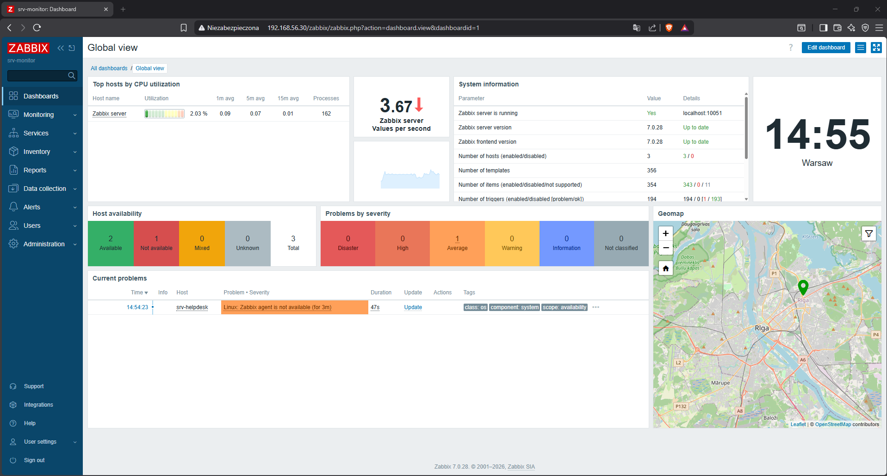

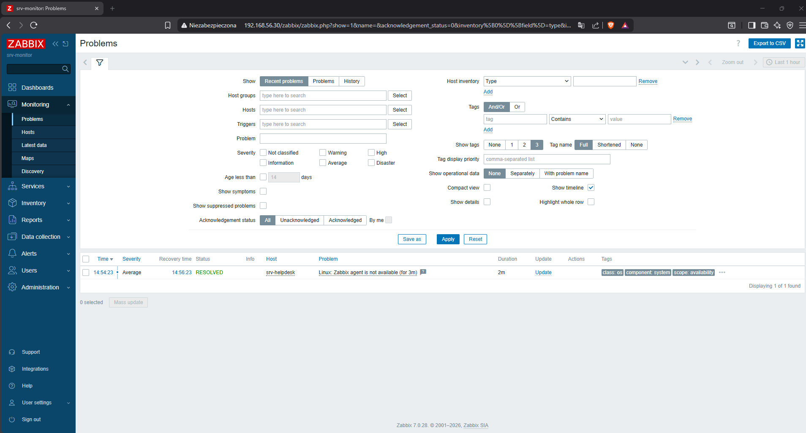

Pozostała dokumentacja etapu: `29`–`49`

## Etap 5: Kopia zapasowa i odtwarzanie

Kopia zapasowa serwera `srv-helpdesk` realizowana skryptem `backup-glpi.sh`. Skrypt wykonuje dwie operacje: zrzut bazy MariaDB oraz archiwum katalogu danych GLPI (`/var/www/html/glpi/files`, zawierającego m.in. sesje i klucze oauth). Wynik zapisywany do `/opt/backup/glpi/` z datą w nazwie pliku (`glpidb_<data>.sql.gz`, `glpi-files_<data>.tar.gz`).

Uwierzytelnianie do MariaDB realizowane przez plik poświadczeń `/opt/backup/.my.cnf` (`--defaults-extra-file`), a nie przez hasło wpisane w treści skryptu.

Skrypt wymaga uprawnień roota - katalog `files/_sessions` oraz `config/oauth.pem` należą do `www-data`, przez co uruchomienie z konta zwykłego użytkownika kończy się błędem `Permission denied` na etapie archiwizacji. Uruchomienie przez `sudo` obejmuje cały katalog.

Pełny skrypt: `skrypty/backup-glpi.sh`.

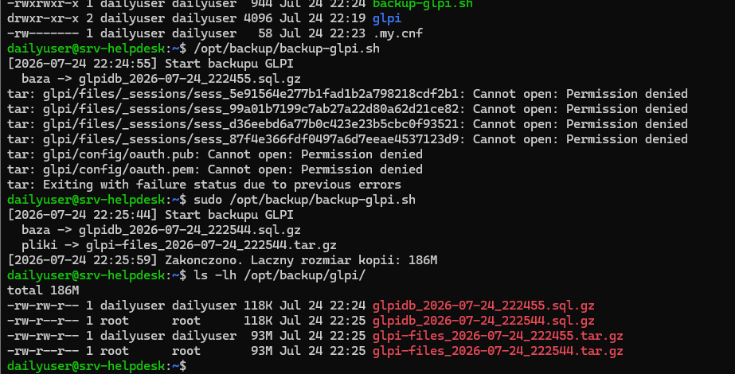

Automatyzacja przez cron - kopia codziennie o 02:00, wyjście przekierowane do logu:

```
0 2 * * * /opt/backup/backup-glpi.sh >> /opt/backup/backup.log 2>&1
```


### Test odtworzenia

Sama kopia nie jest dowodem sprawności procedury - istotne jest odtworzenie. Test przeprowadzono na działającej instancji GLPI.

Stan wyjściowy: 10 kont użytkowników.

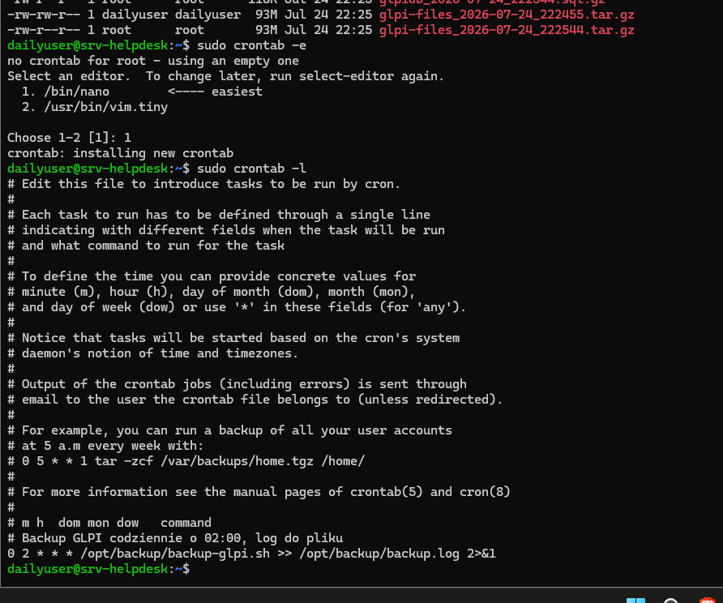

Usunięto konto `tomasz.lewandowski` - pozostaje 9 kont.

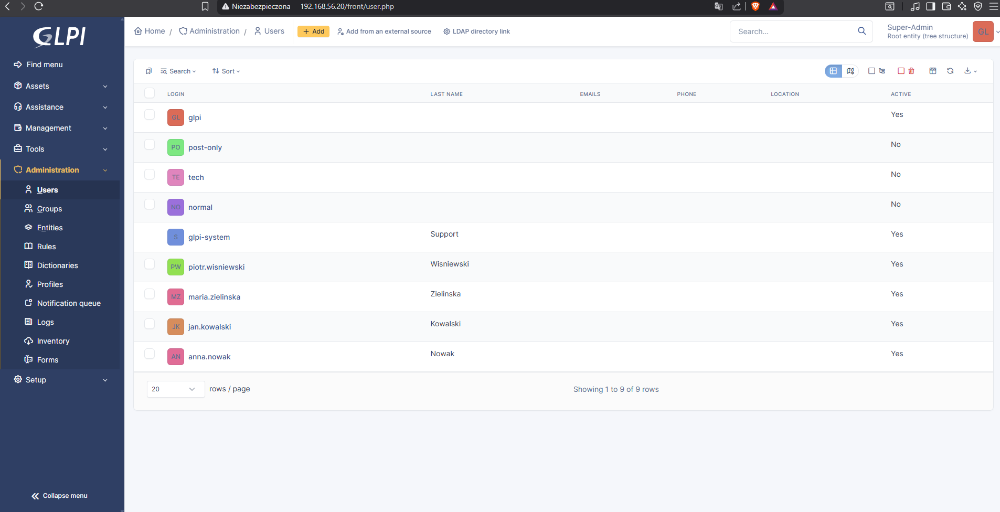

Odtworzenie bazy ze zrzutu:

```bash
gunzip < /opt/backup/glpi/glpidb_2026-07-24_222544.sql.gz \
  | sudo mysql --defaults-extra-file=/opt/backup/.my.cnf glpidb
```

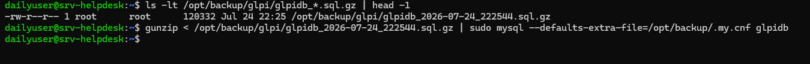

Stan po odtworzeniu: ponownie 10 kont, `tomasz.lewandowski` przywrócony.

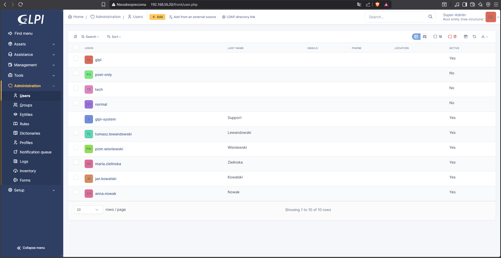

### Konfiguracja pfSense

Konfiguracja firewalla eksportowana do pliku XML (Diagnostics -> Backup & Restore, opcja Skip RRD data). Odtworzenie odbywa się przez wgranie pliku i restart urządzenia.

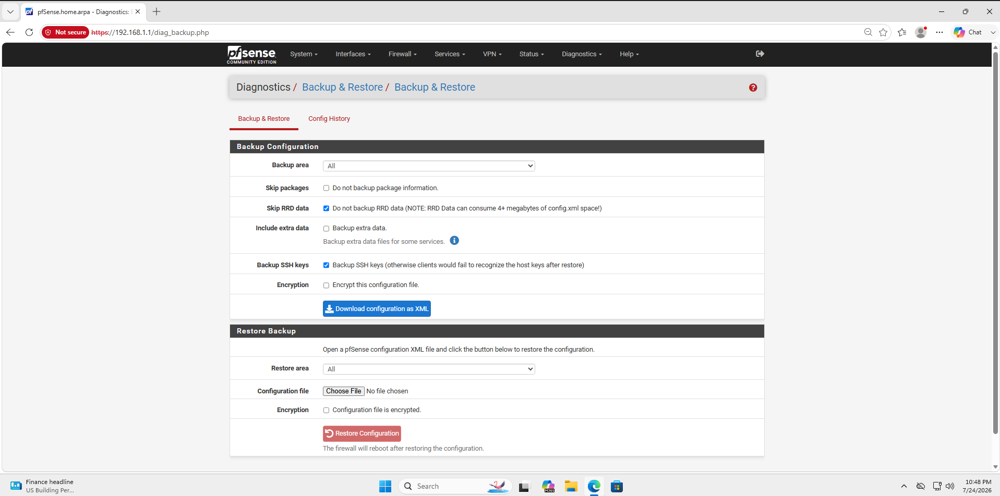

Pozostała dokumentacja etapu: `50`–`56`

## Runbooki

Krótkie procedury diagnostyczne dla typowych zgłoszeń helpdeskowych w tym
środowisku, w katalogu `runbooki/`:

- [`01-glpi-logowanie-domenowe.md`](runbooki/01-glpi-logowanie-domenowe.md) - użytkownik nie może zalogować się do GLPI kontem domenowym
- [`02-brak-dostepu-dysk-sieciowy.md`](runbooki/02-brak-dostepu-dysk-sieciowy.md) - brak dostępu do zmapowanego dysku sieciowego
- [`03-zabbix-brak-danych-z-hosta.md`](runbooki/03-zabbix-brak-danych-z-hosta.md) - Zabbix zgłasza brak danych z hosta

## Struktura repozytorium

```
.
├── README.md
├── skrypty/
│   ├── tworz-uzytkownikow.ps1   zakladanie kont AD i struktury OU
│   └── backup-glpi.sh           kopia zapasowa GLPI (baza + pliki)
├── diagram/
│   └── topologia-sieci.drawio   edytowalny schemat sieci
├── runbooki/
│   ├── 01-glpi-logowanie-domenowe.md
│   ├── 02-brak-dostepu-dysk-sieciowy.md
│   └── 03-zabbix-brak-danych-z-hosta.md
└── screeny/
    ├── 01-04  konfiguracja sieci i pfSense
    ├── 05-18  Active Directory, GPO, serwer plikow
    ├── 19-28  GLPI i integracja LDAP
    ├── 29-49  monitoring Zabbix
    └── 50-56  kopia zapasowa i test odtwarzania
```

## Uwagi

Środowisko ma charakter laboratoryjny. Poświadczenia użyte w konfiguracji nie znajdują się w repozytorium. Komunikacja LDAP odbywa się na porcie 389 bez szyfrowania, agenci Zabbix pracują bez PSK - w środowisku produkcyjnym wymagałoby to odpowiednio LDAPS oraz szyfrowania komunikacji agent–serwer. Kopie zapasowe przechowywane są lokalnie na tym samym hoście co dane źródłowe - w środowisku produkcyjnym konieczna byłaby kopia na osobnym nośniku lub w innej lokalizacji.